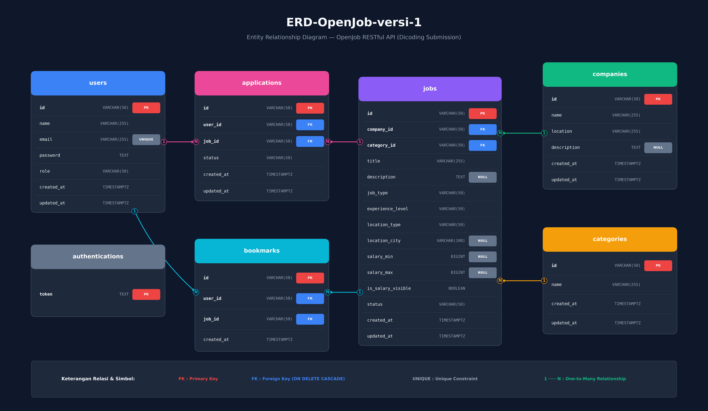

<!-- dikerjakan oleh: distania_9 -->
# OpenJob RESTful API Versi 1

OpenJob RESTful API adalah proyek submission untuk kelas **Menjadi Back-End Developer Expert / Fundamental dengan JavaScript** di Dicoding. API ini mengelola lowongan pekerjaan (*job listings*), perusahaan (*companies*), kategori lowongan (*categories*), lamaran (*applications*), bookmark lowongan (*bookmarks*), autentikasi pengguna (*authentication*), dan profil pengguna (*user profile*).

API ini dibangun dengan arsitektur bersih (*Clean Architecture* & pemisahan *layer* yang terstruktur), mematuhi standar RESTful API, dan lulus **100% dari 100 requests (296 assertions)** pada pengujian Postman resmi dari Dicoding.

> [!NOTE]
> **Docker Tidak Diperlukan**: Proyek ini dirancang dan dikonfigurasi untuk berjalan secara murni menggunakan runtime **Node.js** lokal dan instance basis data **PostgreSQL lokal** yang terpasang langsung pada sistem operasi host (*bare metal*), tanpa memerlukan Docker, Docker Compose, atau containerization.

---

## 🚀 Fitur & Kemampuan

1. **Pengguna (*Users*)**:
   - Registrasi pengguna baru dengan validasi data ketat (nama, email unik, password terenkripsi bcrypt, role).
   - Mengambil informasi profil pengguna berdasarkan ID.

2. **Autentikasi (*Authentications*)**:
   - Login pengguna menghasilkan *Access Token* (JWT) dan *Refresh Token*.
   - Refresh token disimpan dan divalidasi ke database `authentications`.
   - Pembaruan *Access Token* menggunakan *Refresh Token*.
   - Logout / pencabutan *Refresh Token*.

3. **Perusahaan (*Companies*)**:
   - CRUD lengkap data perusahaan (*name*, *location*, *description*).
   - Pengelolaan data terlindungi dengan otentikasi JWT Bearer token.
   - Endpoint publik untuk daftar perusahaan dan detail perusahaan.

4. **Kategori (*Categories*)**:
   - CRUD kategori pekerjaan (*Software Engineering*, dll).
   - Pembuatan dan pembaruan divalidasi dengan otentikasi.
   - Endpoint publik untuk daftar dan detail kategori.

5. **Lowongan Pekerjaan (*Jobs*)**:
   - CRUD lowongan pekerjaan dengan relasi ke *companies* dan *categories*.
   - Filter pencarian canggih via query parameter:
     - `?title=` untuk pencarian berdasarkan judul pekerjaan (*case-insensitive partial match*).
     - `?company-name=` untuk pencarian berdasarkan nama perusahaan.
     - Kombinasi `?title=&company-name=`.
   - Mengambil daftar pekerjaan berdasarkan `companyId` dan `categoryId`.
   - Informasi detail pekerjaan menyertakan nama perusahaan (`company_name`) dan kategori (`category_name`).

6. **Lamaran Pekerjaan (*Applications*)**:
   - Pengajuan lamaran pekerjaan oleh pencari kerja.
   - Pengambilan seluruh lamaran (dengan autentikasi).
   - Pengambilan lamaran berdasarkan ID lamaran, ID user, atau ID job.
   - Pembaruan status lamaran (`pending`, `accepted`, `rejected`).
   - Pembatalan / penghapusan lamaran.

7. **Bookmark (*Bookmarks*)**:
   - Menyimpan lowongan favorit pengguna (`POST /jobs/:jobId/bookmark`).
   - Melihat seluruh bookmark milik pengguna yang terautentikasi (`GET /bookmarks`).
   - Mengambil detail bookmark (`GET /jobs/:jobId/bookmark/:bookmarkId`).
   - Menghapus bookmark lowongan (`DELETE /jobs/:jobId/bookmark`).

8. **Profil Pengguna (*Profile - Kriteria Tingkat Lanjut*)**:
   - Melihat profil lengkap pengguna terautentikasi (`GET /profile`).
   - Melihat riwayat lamaran pengguna terautentikasi (`GET /profile/applications`).
   - Melihat daftar bookmark pengguna terautentikasi (`GET /profile/bookmarks`).

---

## 🛠️ Teknologi yang Digunakan

- **Runtime**: Node.js (CommonJS, v18+ / v20+)
- **Web Framework**: Express.js (v4.21+)
- **Database**: PostgreSQL lokal (v12+)
- **Driver Basis Data**: `pg` (node-postgres)
- **Migration Tool**: `node-pg-migrate`
- **Validation**: Joi (v17+)
- **Security & Tokens**: `bcrypt` (hashing sandi), `jsonwebtoken` (JWT Access & Refresh Token)
- **ID Generator**: `nanoid`
- **Automated Testing**: Newman (Automated Postman Collection Runner)

---

## 🗄️ Database Entity Relationship Diagram (ERD)

Diagram ERD disimpan pada berkas [`ERD-OpenJob-versi-1.png`](ERD-OpenJob-versi-1.png) dan [`ERD-OpenJob-versi-1.jpg`](ERD-OpenJob-versi-1.jpg) di root repository.



```
+--------------------------------------------------------------------+
|                         ERD-OpenJob-versi-1                        |
+--------------------------------------------------------------------+
|  [users] (1) <---------- (N) [applications] (N) ---------> (1) [jobs]
|     ^                             ^                              ^
|     |                             |                              |
|  [users] (1) <---------- (N)  [bookmarks]  (N) -----------> (1) [jobs]
|                                                                  |
|  [companies] (1) <----------------------------------------- (N) [jobs]
|  [categories](1) <----------------------------------------- (N) [jobs]
|                                                                    |
|  [authentications] (Penyimpanan session token refresh)             |
+--------------------------------------------------------------------+
```

---

## 📋 Prasyarat Sistem (*Prerequisites*)

Sebelum menjalankan proyek ini, pastikan sistem lokal Anda telah terpasang:
1. **Node.js**: Versi 18.x, 20.x, atau yang lebih baru ([Unduh Node.js](https://nodejs.org/)).
2. **PostgreSQL**: Terpasang langsung di komputer lokal Anda ([Unduh PostgreSQL](https://www.postgresql.org/download/)).
3. **Git**: Untuk kloning repository ([Unduh Git](https://git-scm.com/)).

Pastikan service PostgreSQL lokal Anda telah aktif dan berjalan (default port `5432`).

---

## ⚙️ Panduan Menyiapkan Basis Data & Environment

### 1. Buat Basis Data PostgreSQL Lokal

Buka terminal atau command prompt, lalu buat basis data baru bernama `openjob_db` menggunakan salah satu cara berikut:

#### Opsi A — Menggunakan perintah `psql` (CLI Interaktif):
```bash
psql -U postgres
```
Masukkan password akun `postgres` Anda, kemudian eksekusi query SQL berikut:
```sql
CREATE DATABASE openjob_db;
\q
```

#### Opsi B — Menggunakan perintah `createdb`:
```bash
createdb -U postgres openjob_db
```

#### Opsi C — Menggunakan Antarmuka Grafis (pgAdmin 4 / DBeaver / TablePlus):
1. Buka **pgAdmin 4** (atau tool database manajemen favorit Anda).
2. Hubungkan ke server PostgreSQL lokal.
3. Klik kanan pada menu **Databases** > pilih **Create** > **Database...**.
4. Ketikkan nama database: `openjob_db`, lalu klik **Save**.

---

### 2. Konfigurasi Berkas Environment (`.env`)

Salin berkas template `.env.example` menjadi `.env`:

```bash
# Di Windows Command Prompt:
copy .env.example .env

# Di PowerShell / Linux / macOS:
cp .env.example .env
```

Buka berkas `.env` dan sesuaikan nilainya dengan konfigurasi PostgreSQL lokal Anda:

```env
# dikerjakan oleh: distania_9
# Server Configuration
HOST=localhost
PORT=3000

# PostgreSQL Configuration
PGUSER=postgres
PGPASSWORD=password
PGDATABASE=openjob_db
PGHOST=localhost
PGPORT=5432

# JWT Secrets
ACCESS_TOKEN_KEY=openjob_super_secret_access_token_key_2026
REFRESH_TOKEN_KEY=openjob_super_secret_refresh_token_key_2026
ACCESS_TOKEN_AGE=10800
```

> [!IMPORTANT]
> Sesuaikan `PGUSER` dan `PGPASSWORD` dengan akun pengguna PostgreSQL lokal yang Anda gunakan saat instalasi PostgreSQL.

---

## 📦 Panduan Instalasi dan Menjalankan Aplikasi

### 1. Instalasi Dependensi Proyek
Jalankan perintah berikut di direktori root proyek:
```bash
npm install
```

### 2. Menjalankan Migrasi Basis Data
Terapkan seluruh skema tabel ke basis data `openjob_db` menggunakan `node-pg-migrate`:
```bash
npm run migrate:up
```

Untuk membatalkan (*rollback*) migrasi:
```bash
npm run migrate:down
```

### 3. Menjalankan Server API

#### Mode Pengembangan (*Development* dengan auto-reload Nodemon):
```bash
npm run start:dev
```

#### Mode Produksi (*Production*):
```bash
npm start
```

Setelah server aktif, Anda akan melihat pesan:
```text
Server OpenJob API berjalan pada http://localhost:3000
```

---

## 🧪 Panduan Menjalankan Pengujian Otomatis (Newman / Postman)

Pengujian resmi Dicoding dijalankan menggunakan berkas koleksi dan environment resmi yang ada di folder [`Postman/`](Postman/):
- `Postman/OpenJob API.postman_environment.json`
- `Postman/[271] OpenJob API Test V1.postman_collection.json`

### Menjalankan Pengujian Otomatis via Terminal (Newman)
Cukup jalankan satu perintah berikut:
```bash
npm test
```

Skrip penguji [`tests/run-postman.js`](tests/run-postman.js) akan secara otomatis:
1. Menghubungkan ke PostgreSQL lokal dan membersihkan (*truncate*) tabel untuk menjamin kondisi pengujian yang konsisten dan bersih.
2. Menjalankan server aplikasi pada port `3000`.
3. Mengeksekusi seluruh 100 requests (113 siklus uji dinamis) dan 296 asersi menggunakan runner Newman.
4. Menampilkan ringkasan hasil pengujian secara terperinci.

Hasil pengujian resmi:
```text
┌─────────────────────────┬──────────────────┬─────────────────┐
│                         │         executed │          failed │
├─────────────────────────┼──────────────────┼─────────────────┤
│              iterations │                1 │               0 │
├─────────────────────────┼──────────────────┼─────────────────┤
│                requests │              113 │               0 │
├─────────────────────────┼──────────────────┼─────────────────┤
│            test-scripts │              111 │               0 │
├─────────────────────────┼──────────────────┼─────────────────┤
│      prerequest-scripts │               22 │               0 │
├─────────────────────────┼──────────────────┼─────────────────┤
│              assertions │              296 │               0 │
└─────────────────────────┴──────────────────┴─────────────────┘
=============================================
            RINGKASAN HASIL PENGUJIAN
=============================================
Requests:   Total: 113, Gagal: 0
Assertions: Total: 296, Gagal: 0

SELURUH PENGUJIAN BERHASIL LULUS! (100% PASS RATE)
```

---

### Menjalankan Pengujian Melalui Aplikasi Postman Desktop

Jika Anda ingin menguji secara manual menggunakan GUI Postman:
1. Pastikan server API sedang berjalan (`npm run start:dev`).
2. Buka aplikasi **Postman**.
3. Klik tombol **Import**, lalu pilih berkas:
   - `Postman/OpenJob API.postman_environment.json`
   - `Postman/[271] OpenJob API Test V1.postman_collection.json`
4. Di pojok kanan atas Postman, pilih environment aktif: **OpenJob API**.
5. Klik kanan pada koleksi **[271] OpenJob API Test V1** > pilih **Run Collection**.
6. Klik tombol **Run [271] OpenJob API Test V1**.

---

## 📋 Daftar Endpoint API

| Method | Endpoint | Keterangan | Autentikasi |
|---|---|---|---|
| `POST` | `/users` | Pendaftaran pengguna baru | Tidak |
| `GET` | `/users/:id` | Mengambil data pengguna | Tidak |
| `POST` | `/authentications` | Login pengguna (menghasilkan JWT) | Tidak |
| `PUT` | `/authentications` | Memperbarui Access Token | Tidak |
| `DELETE` | `/authentications` | Logout pengguna / pencabutan token | Ya (Bearer) |
| `POST` | `/companies` | Menambahkan perusahaan | Ya (Bearer) |
| `GET` | `/companies` | Mengambil seluruh perusahaan | Tidak |
| `GET` | `/companies/:id` | Mengambil detail perusahaan | Tidak |
| `PUT` | `/companies/:id` | Memperbarui data perusahaan | Ya (Bearer) |
| `DELETE` | `/companies/:id` | Menghapus perusahaan | Ya (Bearer) |
| `POST` | `/categories` | Menambahkan kategori lowongan | Ya (Bearer) |
| `GET` | `/categories` | Mengambil seluruh kategori | Tidak |
| `GET` | `/categories/:id` | Mengambil detail kategori | Tidak |
| `PUT` | `/categories/:id` | Memperbarui kategori | Ya (Bearer) |
| `DELETE` | `/categories/:id` | Menghapus kategori | Ya (Bearer) |
| `POST` | `/jobs` | Menambahkan lowongan pekerjaan | Ya (Bearer) |
| `GET` | `/jobs` | Mengambil lowongan (filter `?title=&company-name=`) | Tidak |
| `GET` | `/jobs/company/:companyId` | Mengambil lowongan berdasarkan perusahaan | Tidak |
| `GET` | `/jobs/category/:categoryId` | Mengambil lowongan berdasarkan kategori | Tidak |
| `GET` | `/jobs/:id` | Mengambil detail lowongan | Tidak |
| `PUT` | `/jobs/:id` | Memperbarui lowongan pekerjaan | Ya (Bearer) |
| `DELETE` | `/jobs/:id` | Menghapus lowongan pekerjaan | Ya (Bearer) |
| `POST` | `/applications` | Mengajukan lamaran pekerjaan | Ya (Bearer) |
| `GET` | `/applications` | Mengambil seluruh lamaran | Ya (Bearer) |
| `GET` | `/applications/:id` | Mengambil detail lamaran | Ya (Bearer) |
| `GET` | `/applications/user/:userId` | Mengambil lamaran berdasarkan user | Ya (Bearer) |
| `GET` | `/applications/job/:jobId` | Mengambil lamaran berdasarkan job | Ya (Bearer) |
| `PUT` | `/applications/:id` | Memperbarui status lamaran | Ya (Bearer) |
| `DELETE` | `/applications/:id` | Menghapus lamaran | Ya (Bearer) |
| `POST` | `/jobs/:jobId/bookmark` | Menambahkan bookmark lowongan | Ya (Bearer) |
| `GET` | `/bookmarks` | Mengambil seluruh bookmark user | Ya (Bearer) |
| `GET` | `/jobs/:jobId/bookmark/:bookmarkId` | Mengambil detail bookmark | Ya (Bearer) |
| `DELETE` | `/jobs/:jobId/bookmark` | Menghapus bookmark lowongan | Ya (Bearer) |
| `GET` | `/profile` | Mengambil profil user terautentikasi | Ya (Bearer) |
| `GET` | `/profile/applications` | Mengambil lamaran user terautentikasi | Ya (Bearer) |
| `GET` | `/profile/bookmarks` | Mengambil bookmark user terautentikasi | Ya (Bearer) |
